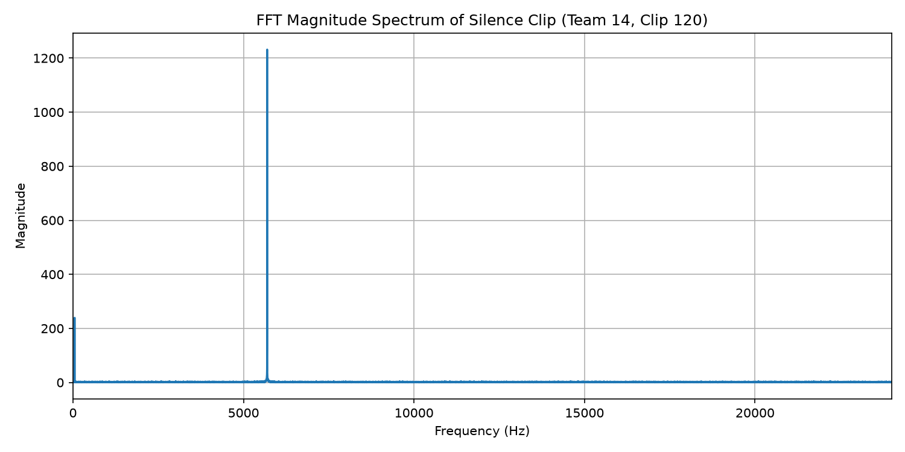
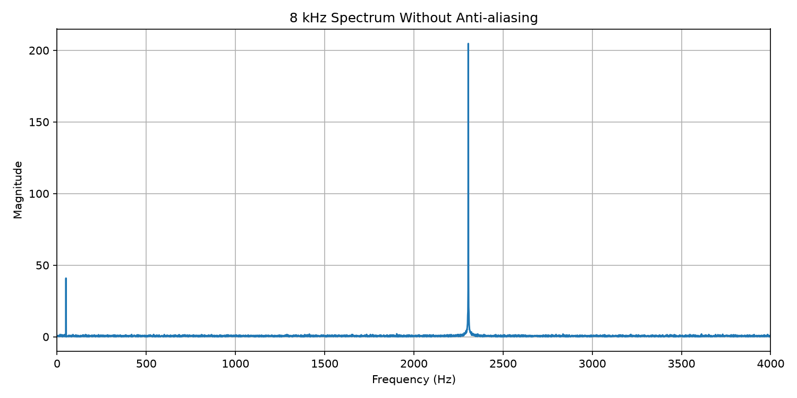
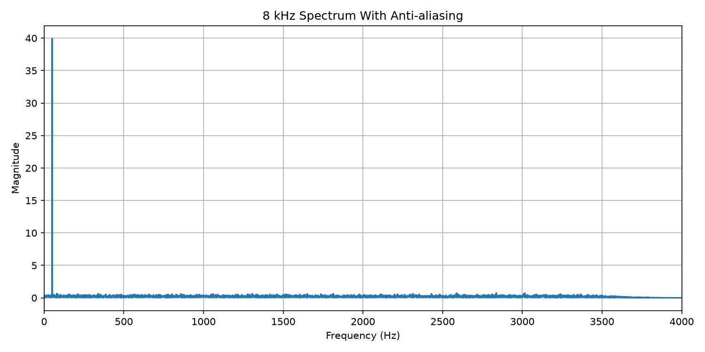
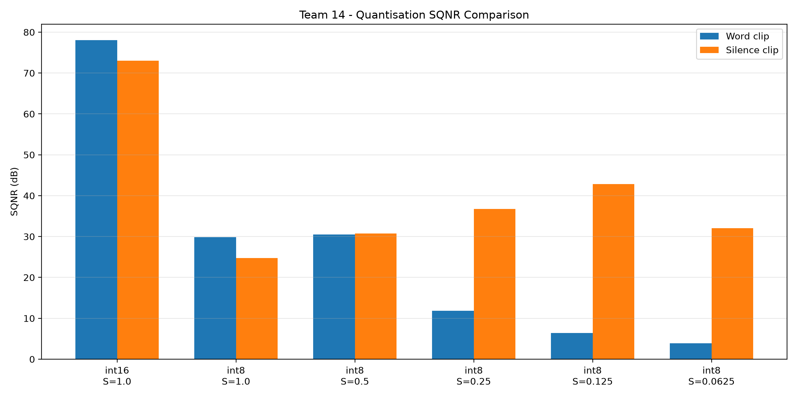
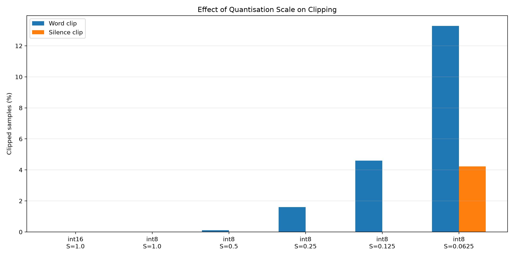
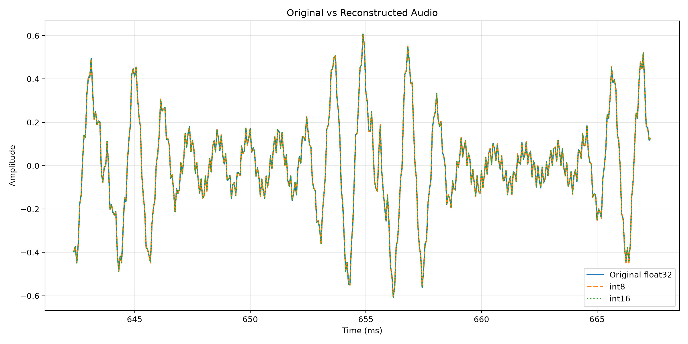
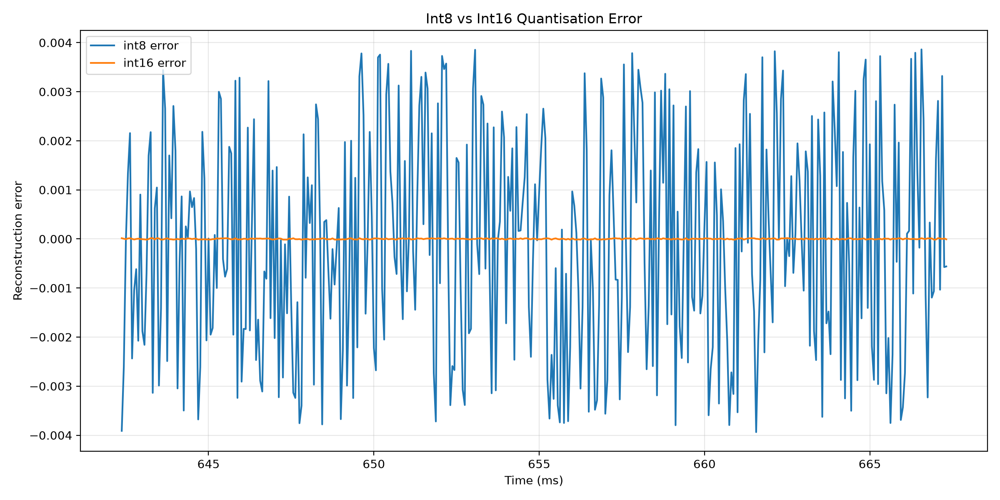
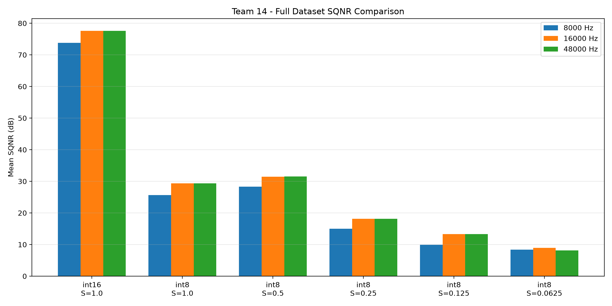
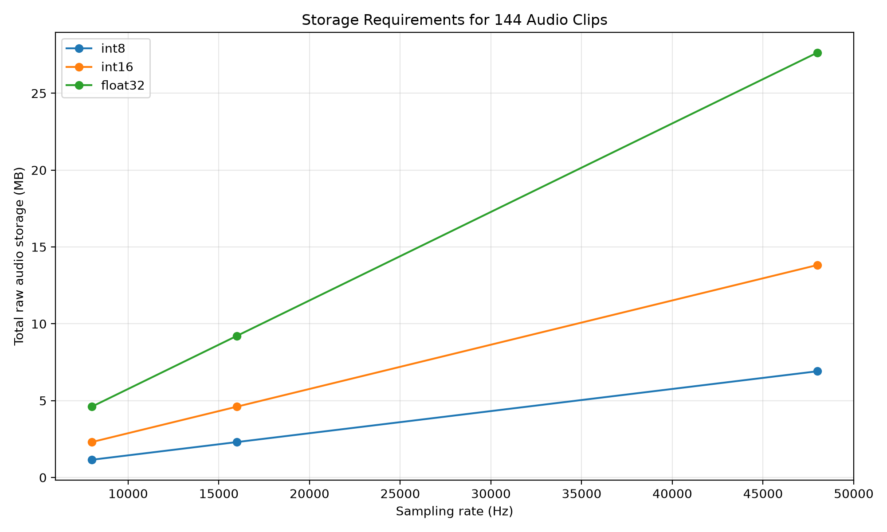

# Mission 2 — What to send, and where to keep it

**AI255TBD Edge AI · Module 2: The Doorbell's Ears**  
**Team 14 — Saura** · Python/signal-processing workstream  
**Status:** Python experiments executed; configuration recommended; final evidence packaging and board persistence verification pending.  
**Scope:** The team plan assigns this analysis to Sumadhwa J and board storage to Srijan Kumar GS. The actual local working path reported in the terminal is `srijan/mission2/`; reconcile ownership and folder naming before the team handoff.  
**Evidence:** User-supplied terminal outputs and screenshots, the original assignment README and TEAM_PLAN, and Vaibhav's `VAIBHAV_HANDOVER.md` in the supplied archive. The updated local scripts and generated CSV/PNG files were not independently inspected or rerun for this report.

## 1. Aim

Determine a practical audio sampling rate, integer representation and fixed quantisation scale for the ESP32-S3 smart doorbell. Implement and test packing/unpacking, demonstrate aliasing and filtering, measure reconstruction fidelity and clipping on Team 14 audio, and estimate the recording size and transmission rate. Hand the results to the firmware owner for SRAM, PSRAM and persistent flash tests.

## 2. Background

Team 14 has 144 mono one-second clips, 24 each of `on`, `off`, `stop`, `go`, `_unknown`, `_silence`. The source uses synthetic speech, room noise, mains hum and a regulator whine. Silence therefore is not an all-zero signal. `team_audio.py` and `speech_pool.npz` are immutable assignment inputs.

Nyquist frequency is fs/2. A sinusoidal component above Nyquist folds into the representable band at its distance from the nearest integer multiple of fs. An anti-alias low-pass filter must operate **before** samples are discarded; afterwards the unwanted component overlaps valid lower frequencies. The supplied generator implements a 255-tap Blackman-windowed sinc low-pass filter with cutoff 0.45 times the output sampling rate, followed by decimation. At 8 kHz the cutoff is 3.6 kHz; at 16 kHz it is 7.2 kHz, so the regulator whine near 5.695 kHz remains in-band at 16 kHz.

For integer bit width b and positive scale S, the assignment defines:

```text
q = clip(round(x / S * (2**(b-1)-1)), -2**(b-1), 2**(b-1)-1)
xhat = q * S / (2**(b-1)-1)
```

Int8 uses signed one-byte values; int16 uses signed little-endian two-byte values. Packing serialises the quantised values to bytes and unpacking reconstructs float32 audio. SQNR in dB is `10*log10(mean(x**2)/mean((x-xhat)**2))`. Clipping is counted when the rounded integer exceeds the representable range. A smaller scale yields finer resolution but less headroom.

## 3. Prediction

The following theoretical expectations were discussed before the corresponding experiments; they are not independent hardware measurements.

- At 16 kHz, float32, int16 and int8 require 64,000, 32,000 and 16,000 payload bytes/s, respectively.
- With S=1, the non-clipped rounding-error bound is half the step: 0.003937008 for int8 and 0.0000152593 for int16, neglecting floating-point rounding.
- After measuring the original peak at 5,695 Hz, the predicted alias at 8 kHz was `abs(8000-5695) = 2305 Hz`. Filtering should strongly suppress this peak.
- Int16 should have substantially higher SQNR than int8; reducing int8 scale should improve quiet-signal resolution until clipping dominates.
- At 16 kHz int16, 144 seconds should occupy 4,608,000 raw bytes before filesystem or metadata overhead.

## 4. Method

### 4.1 Setup and implementation

The student reported Windows PowerShell, Python 3.11.9, a `.venv` environment and installation of NumPy, PySerial and Matplotlib. `python team_audio.py 14` produced `team_14_preview.wav` and confirmed all 144 clips.

Scripts reported in `srijan/mission2/`:

| Script | Purpose |
|---|---|
| `quantisation.py` | Quantise, serialise little-endian bytes, reconstruct float32 |
| `test_quantisation.py` | Check values, types, clipping, scale, payload length and reconstruction tolerance |
| `sampling_analysis.py` | FFT spectra at 48 and 8 kHz, with/without anti-alias filtering; attenuation |
| `sqnr_analysis.py` | Compare six bit-width/scale settings on clips 0 and 120 at 16 kHz |
| `dataset_validation.py` | Sweep the same settings at 8, 16 and 48 kHz across all 144 clips |

Run the scripts from the repository root with the virtual environment active. Use `python srijan/mission2/<script>.py`. The validation sweep evaluates 144 × 3 × 6 = 2,592 clip/configuration pairs; `antialias=True` is passed throughout (at native 48 kHz no decimation filter is applied by the source).

### 4.2 Spectral analysis

Load clip 120 (`_silence`) at 48 kHz without filtering, 8 kHz without filtering and 8 kHz with filtering. Use `np.fft.rfft` and `np.fft.rfftfreq` to find the strongest non-DC bin. Calculate attenuation at the same 2,305 Hz bin for the two 8 kHz signals as `20*log10(before/after)`. The original screenshots use raw FFT magnitude; the assignment additionally requests dB spectra, so create normalized amplitude spectra in dB before final submission. A suitable convention is `20*log10(max(2*abs(rfft(x))/N, 1e-12))`, with DC and the even-length Nyquist bin not doubled.

### 4.3 SQNR and clipping

Use `pack()` and `unpack()` to simulate the actual wire representation. Compare reconstructed and original samples at the same sampling rate. The configurations are int16 S=1 and int8 S=1, 0.5, 0.25, 0.125, 0.0625. Count clipped samples and affected clips separately. The dataset summary reports the arithmetic mean of individual clip SQNRs in dB and the minimum individual clip SQNR, not a single pooled SQNR.

## 5. Observations

### 5.1 Unit tests

Original inputs: `[-1, -0.5, 0, 0.5, 1]`.

| Metric | int8 | int16 |
|---|---|---|
| Quantised values | -127, -64, 0, 64, 127 | -32767, -16384, 0, 16384, 32767 |
| Payload length | 5 B | 10 B |
| Reconstructed half-scale magnitude | 0.503937 | 0.50001526 |
| Maximum reconstruction error | 0.0039370059967041016 | 0.0000152587890625 |
| Test output | Passed | Passed |

The terminal reported all quantisation and packing/unpacking tests passed. Save actual unpacked test arrays for the handoff; the terminal outputs alone are not array files.

### 5.2 Aliasing and anti-alias filtering

At 48 kHz, clip 120 has shape `(48000,)`, dtype float32, minimum -0.085849755 and maximum 0.09025083.

| Measurement | 48 kHz original | 8 kHz unfiltered | 8 kHz filtered |
|---|---:|---:|---:|
| Samples | 48,000 | 8,000 | 8,000 |
| Nyquist (Hz) | 24,000 | 4,000 | 4,000 |
| Dominant frequency (Hz) | 5695 | 2305 | 50 |
| Raw FFT peak magnitude | 1231.8064 | 204.719757 | 39.935978 |

Predicted alias 2,305 Hz; observed 2,305 Hz (zero difference at the 1 Hz FFT-bin resolution). At 2,305 Hz the magnitude decreased from 204.719757 to 0.472255: **52.74 dB attenuation**, approximately 99.77% reduction in magnitude. The 50 Hz peak is consistent with simulated mains hum and is not the residual alias magnitude.

Original plots (relative to `mission2/`):







### 5.3 Word and silence quantisation

At 16 kHz with filter enabled, clip 0 (`on`) peak amplitude = 0.607413, RMS = 0.070494. Clip 120 peak amplitude = 0.076177, RMS = 0.039335. Each contains 16,000 samples.

| Format | Scale | Word SQNR (dB) | Silence SQNR (dB) | Word clipped (%) | Silence clipped (%) | Bytes/clip |
|---|---:|---:|---:|---:|---:|---:|
| int16 | 1 | 78.07 | 72.99 | 0 | 0 | 32000 |
| int8 | 1 | 29.85 | 24.78 | 0 | 0 | 16000 |
| int8 | 0.5 | 30.49 | 30.79 | 0.1063 | 0 | 16000 |
| int8 | 0.25 | 11.83 | 36.78 | 1.6062 | 0 | 16000 |
| int8 | 0.125 | 6.38 | 42.83 | 4.6000 | 0 | 16000 |
| int8 | 0.0625 | 3.88 | 32.08 | 13.2875 | 4.2188 | 16000 |

Best tested zero-clipping int8 scale: word S=1 (29.85 dB); silence S=0.125 (42.83 dB).









### 5.4 All 144 clips

| fs (Hz) | Format | S | Mean SQNR (dB) | Min SQNR (dB) | Clipped samples (%) | Clipped clips /144 |
|---:|---|---:|---:|---:|---:|---:|
| 8000 | int16 | 1 | 73.82 | 58.57 | 0 | 0 |
| 8000 | int8 | 1 | 25.65 | 10.37 | 0 | 0 |
| 8000 | int8 | 0.5 | 28.28 | 16.34 | 0.1121 | 64 |
| 8000 | int8 | 0.25 | 14.98 | 8.07 | 1.5683 | 120 |
| 8000 | int8 | 0.125 | 9.92 | 3.65 | 4.8595 | 120 |
| 8000 | int8 | 0.0625 | 8.36 | 1.75 | 9.7610 | 120 |
| 16000 | int16 | 1 | 77.56 | 72.92 | 0 | 0 |
| 16000 | int8 | 1 | 29.34 | 24.72 | 0 | 0 |
| 16000 | int8 | 0.5 | 31.49 | 21.48 | 0.1241 | 78 |
| 16000 | int8 | 0.25 | 18.16 | 8.20 | 1.6765 | 120 |
| 16000 | int8 | 0.125 | 13.30 | 3.85 | 5.4285 | 120 |
| 16000 | int8 | 0.0625 | 8.91 | 1.96 | 15.0245 | 144 |
| 48000 | int16 | 1 | 77.61 | 73.06 | 0 | 0 |
| 48000 | int8 | 1 | 29.38 | 24.80 | 0 | 0 |
| 48000 | int8 | 0.5 | 31.50 | 21.46 | 0.1241 | 80 |
| 48000 | int8 | 0.25 | 18.19 | 8.20 | 1.6826 | 120 |
| 48000 | int8 | 0.125 | 13.33 | 3.86 | 5.4573 | 120 |
| 48000 | int8 | 0.0625 | 8.18 | 1.97 | 16.3169 | 144 |

Dataset peak amplitudes: 0.7033449 at 8 kHz, 0.7323102 at 16 kHz and 0.74150205 at 48 kHz. Best tested zero-clipping int8 scale at each rate was 1.0.





### 5.5 Theoretical raw storage for 144 seconds

Decimal MB (1 MB = 1,000,000 B); excludes filesystem metadata and protocol overhead.

| Rate | int8 | int16 | float32 |
|---|---:|---:|---:|
| 8 kHz | 1.152 MB | 2.304 MB | 4.608 MB |
| 16 kHz | 2.304 MB | 4.608 MB | 9.216 MB |
| 48 kHz | 6.912 MB | 13.824 MB | 27.648 MB |

## 6. Analysis

### Recommended baseline for firmware and feature development

- Team 14, 16,000 Hz, anti-alias filter enabled, int16 little-endian, S=1.0 fixed, mono.
- 16,000 samples and 32,000 payload bytes per second; 2,304,000 samples and 4,608,000 bytes (about 4.395 MiB) total.
- At 320 samples per packet: 640 payload bytes + 13 overhead bytes; 50 data packets/s, or 32,650 B/s on the link before commands, END and return traffic. The expected continuous recording has 7,200 data packets if packetization is uninterrupted and fixed at 320 samples.
- Mean SQNR 77.56 dB, minimum 72.92 dB and zero clips requiring saturation across the tested dataset.
- Compared with 16 kHz int8 S=1, the mean SQNR is 48.22 dB higher at twice the payload/storage. Compared with 48 kHz int16, the mean SQNR is only 0.05 dB lower and storage is one third. These SQNR comparisons measure quantisation, not the speech information discarded by resampling; they do not establish classifier accuracy.
- 16 kHz retains more bandwidth than 8 kHz and is consistent with the assignment's Mission 5 baseline. The in-band regulator whine remains a known limitation; do not claim the 16 kHz anti-alias filter eliminates it.
- Use scale 1.0 before listening because the source is bounded to [-1,1]; this avoids dependence on future samples or class labels. On a real microphone, calibrate gain against expected loud inputs and leave headroom. A scale of 0.5 improves average int8 SQNR at 16 kHz but clips 78/144 clips, so it is unsuitable as the default zero-clipping scale. A scale tuned on silence is not generalisable to speech.

### Compatibility with Mission 1 and board storage

Vaibhav's handover reports receive-only throughputs of 11,336, 89,992 and 189,174 B/s at UART baud rates 115200, 921600 and 2000000 respectively. Native USB measured 456,798 B/s with 320-sample packets. The 32,000 B/s payload baseline is above the slow UART capacity but within the measured faster receive-only capacities. At 921600, the 16 kHz int16 single-clip real-time trial took 1.008 s with no CRC or sequence errors. Native USB is the preferred integration candidate, with 320 samples/packet a reasonable starting point; current port identifiers and end-to-end margins must be reverified.

The same handover reports 16 MB flash, 1,441,792-byte LittleFS capacity and no active PSRAM allocation. The selected 4,608,000-byte recording will not fit the reported filesystem: raw deficit 3,166,208 B before overhead. Firmware owner must enable appropriate PSRAM/flash settings, find a partition with sufficient LittleFS space, implement SAVE, stream and verify persistent dump/CRC after unplugging. This report contains no new hardware storage, CRC or persistence results. An int8 S=1 fallback would require 2,304,000 B at 16 kHz and also exceed the old filesystem. The initial feature-return trial reported only 6/49 frames; do not claim completed feature throughput or zero-loss operation.

## 7. What we learnt

- Sampling rate affects representable frequencies, and filtering must happen before decimation.
- The 2,305 Hz peak is an alias, not a new physical source; the measured suppression is 52.74 dB at that bin.
- Raw FFT magnitudes depend on sample count. Compare normalized amplitudes across rates and compare the same frequency for filter attenuation.
- Bit width and scale trade storage against fidelity and headroom. Low clipping percentages can affect many clips, so report both samples and clips.
- A Python round trip demonstrates serialization and quantisation correctness for tested cases, not physical transport, board compute or flash persistence.
- The initial setup encountered a missing test file (Errno 2) and then a silent test invocation. The exact cause of the latter was not confirmed; after creating/saving the correct script the tests printed success. Quantisation code was initially placed after a return inside unpack(), leaving quantise() without a return; it was corrected by restoring function boundaries. The filtered spectrum initially had no figure because only FFT computation had been added; adding the third plotting section resolved it. A KeyboardInterrupt appeared before the final validation run; its exact cause was not established and the subsequent validation completed.

### Evidence and handoff checklist

- [x] Terminal evidence: quantisation, round-trip tests, FFT/aliasing, attenuation, two-clip SQNR, full-dataset sweep.
- [x] Recommended Python baseline and storage estimates.
- [x] Plots reported and shown in screenshots: three linear spectra, four quantisation charts, two validation charts.
- [ ] Save dB versions of the three spectra and export int8/int16 unpacked test arrays; verify they exist.
- [ ] Verify local `results/sqnr_results.csv`, `results/dataset_validation.csv`, `results/configuration_summary.csv`, all plot files and code before committing. Relative image references in this Markdown report expect the existing local plots folder; the image files are not bundled with the report.
- [ ] Reconcile folder/owner with the team plan, review report, add actual role assignments and export/merge into the required Mission 2 PDF.
- [ ] Board owner: SRAM/PSRAM capacity tests, LittleFS SAVE, partition capacity, full recording, unplug/replug, dump and CRC comparison.
- [ ] Mission 3–5 feature, dataset and classifier tasks remain separate.

## 8. LLM log

Draft disclosure based on this conversation; students should verify and supplement it with exact prompts/dates and team roles before submission. The README allows explanations, hints and debugging but explicitly prohibits finished LLM-generated code. The workstream used more than the permitted assistance: ChatGPT supplied complete reference implementations or substantial executable code for quantisation correction, test scripts, spectral analysis, SQNR analysis and full dataset validation, and drafted this report. This must not be represented as hints-only or independent authorship. Review the policy with the instructor, understand and independently implement any code required by the rules before submitting, and preserve an accurate log.

| Topic | Assistance | Evidence / outcome |
|---|---|---|
| Setup and Team 14 | Environment commands and loader guidance | Python 3.11.9; 144-clip preview confirmed |
| Quantisation and bytes | Formula, code correction, test code, tolerance | Unit tests passed; 5/10 B and measured errors |
| FFT and aliasing | FFT/plot snippets; predicted 2305 Hz after 5695 Hz measurement | Measured alias matched prediction |
| Filtering | Filtered-spectrum and attenuation code | 52.74 dB measured at 2305 Hz |
| SQNR and scale | Complete reference script and interpretation | 12 two-clip measurements produced |
| Dataset sweep | Complete reference script | 2592 evaluations; three sampling rates |
| Configuration/report | Baseline proposal and Markdown drafting | Student/team review and hardware confirmation pending |

**Source notes:** Original assignment `README.md`, sections 3–6; `TEAM_PLAN.md`, Sumadhwa and Srijan responsibilities; `team_audio.py` source; `vaibhav/handoff/VAIBHAV_HANDOVER.md`; student terminal outputs and screenshots in this conversation. No additional board experiments were conducted for this draft.
